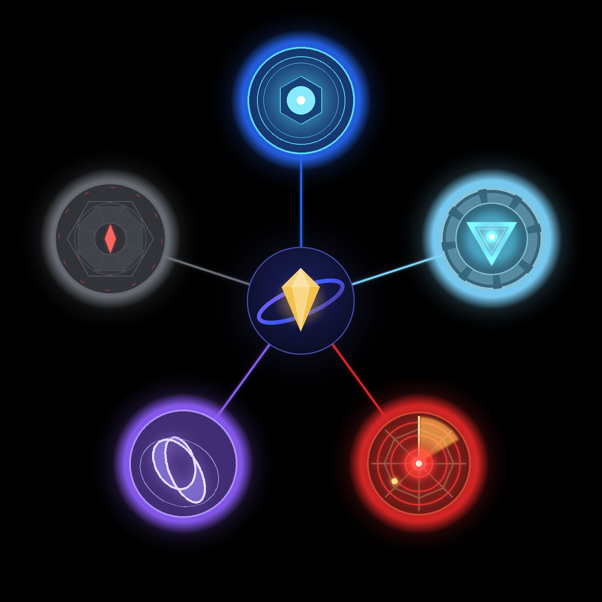

# Assistants

One installer for the whole assistant series. Run **Assistants-Setup**, tick the assistants you want, and each one is installed as its own separate app with its own Start Menu entry.

Download it from the [Releases](../../releases) page.

## The series, oldest to newest

| # | Assistant | What it is | Repo |
|---|-----------|------------|------|
| 1 | **Kairos** | The first assistant: orb UI, OpenAI/Groq/Anthropic, wake word, global hotkey, PC control | [KrishivDaFih/Kairos](https://github.com/KrishivDaFih/Kairos) |
| 2 | **Jarvis** | Iron Man-style HUD with a Mark 85 arc reactor | [KrishivDaFih/Jarvis](https://github.com/KrishivDaFih/Jarvis) |
| 3 | **E.V.** | Spider-Man-inspired assistant with confirm-before-risky-actions computer control | [KrishivDaFih/EV](https://github.com/KrishivDaFih/EV) |
| 4 | **AURA** | Mobius hologram core, dark blue/purple identity | [KrishivDaFih/AURA](https://github.com/KrishivDaFih/AURA) |
| 5 | **ULTRON** | "Sentinel Core" console with PowerShell-based computer control | [KrishivDaFih/Ultron](https://github.com/KrishivDaFih/Ultron) |
| 6 | **Vision** | Hub app that runs all the others as swappable sub-agents with shared memory | [KrishivDaFih/Vision](https://github.com/KrishivDaFih/Vision) |

Each assistant's own repo has its source code and every installer version in its Releases.

## Requirements

- Windows 10 or 11 (64-bit)
- An API key from Anthropic, OpenAI or Groq (entered in each app's settings, stored locally)
